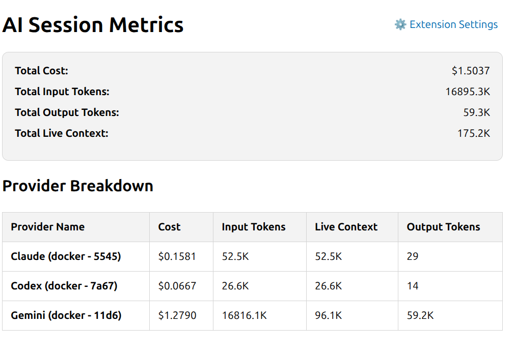
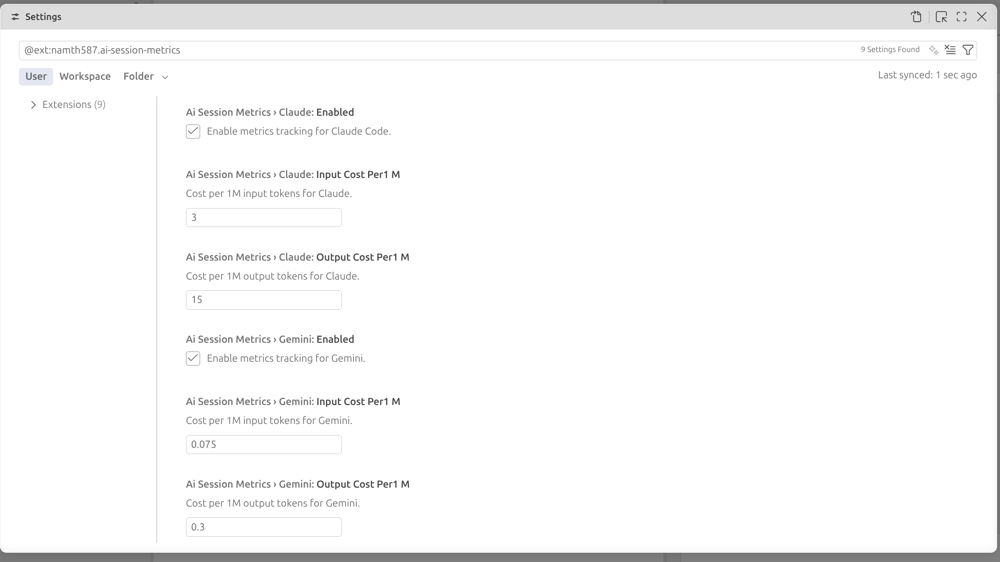

# AI Session Metrics

**AI Session Metrics** is a VS Code companion extension that provides real-time tracking of your AI assistant usage directly from the status bar. Keep track of live context sizes, token usage percentages, and costs across multiple AI tools, ensuring you always know how much context you are consuming.

<p align="center">
  
</p>

## Features

- **Live Status Bar Monitoring**: See a real-time summary of your current session's token consumption in the VS Code status bar.
- **Detailed Metrics Panel**: Click the status bar item (or run the `AI Session Metrics: Show Details` command) to open a comprehensive breakdown of all tracked sessions.
- **Multi-Provider Support**:
  - **Claude Code**: Tracks context usage for local Claude Code sessions.
  - **Gemini**: Supports real-time monitoring of Gemini token usage and costs.
  - **Codex**: Monitors Codex thread history and usage metrics.
- **Smart Active Session Detection**: Automatically filters out inactive sessions (older than 10 minutes) by tracking the exact timestamps of AI activity.
- **Cost Estimation**: Estimates provider costs for input tokens, output tokens, and live context.

<p align="center">
  
</p>

## Installation

**Via VS Code Marketplace:**
1. Open VS Code and navigate to the Extensions view (`Ctrl+Shift+X` / `Cmd+Shift+X`).
2. Search for **AI Session Metrics**.
3. Click **Install**.

**Via Command Palette:**
1. Press `Ctrl+P` (or `Cmd+P` on Mac).
2. Type `ext install namth587.ai-session-metrics` and hit Enter.

**Via VSIX (Manual Installation):**
1. Download the latest `.vsix` file from the project.
2. In the VS Code Extensions view, click the `...` menu in the top right.
3. Select **Install from VSIX...** and choose the downloaded file.

## Configuration

You can customize the extension via your VS Code Settings (`Ctrl+,` or `Cmd+,` and search for "AI Session Metrics"):

| Setting | Description | Default |
|---------|-------------|---------|
| `aiSessionMetrics.[provider].enabled` | Enable or disable metrics tracking for Claude, Gemini, or Codex. | `true` |
| `aiSessionMetrics.[provider].inputCostPer1M` | Set the input cost per 1M tokens for precise cost estimation. | Varies |
| `aiSessionMetrics.[provider].outputCostPer1M` | Set the output cost per 1M tokens for precise cost estimation. | Varies |

<p align="center">
  
</p>

## Getting Started

1. Ensure you have your preferred AI tools running locally (Claude, Gemini, Codex).
2. The extension will automatically detect the active sessions and start parsing the underlying `.claude/projects/` JSONL logs, `.gemini/` transcripts, and `.codex/` SQLite database files to extract real-time metrics.
3. Check your status bar!

## Requirements

- VS Code `^1.90.0` or higher.
- Active usage of Claude Code, Gemini, or Codex in your workspace for data to populate.

## Building / Contributing

If you want to compile and modify the extension locally:
```bash
npm install
npm run compile
# Package to VSIX
npm run package
```

## License

This project is licensed under the [MIT License](LICENSE).

## Legal

- [Privacy Policy](https://namtranhuu.github.io/privacy-policy/)
- [Terms of Use](https://namtranhuu.github.io/privacy-policy/terms-of-use)

Please review these documents before using the software. Third-party services and their own terms may also apply.
